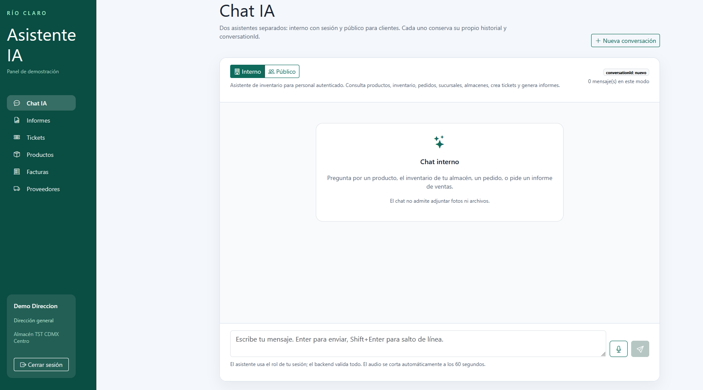
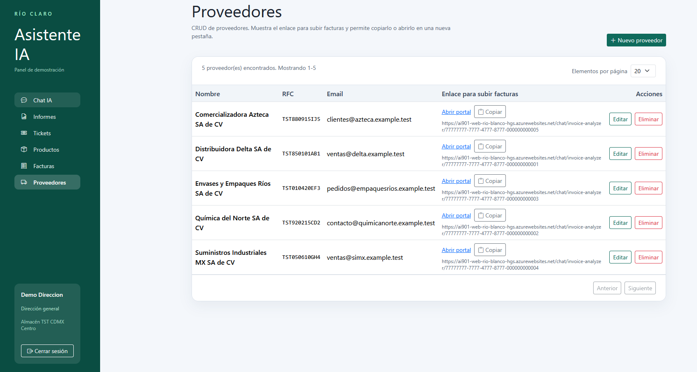
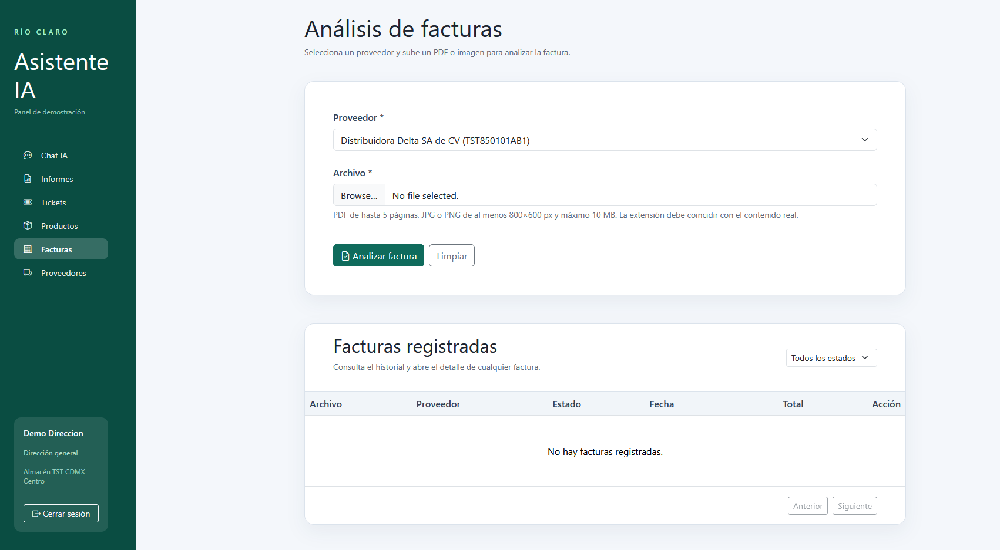
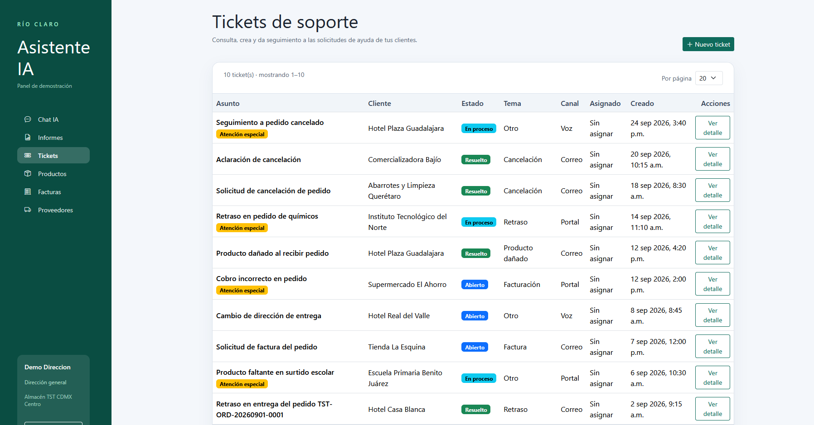
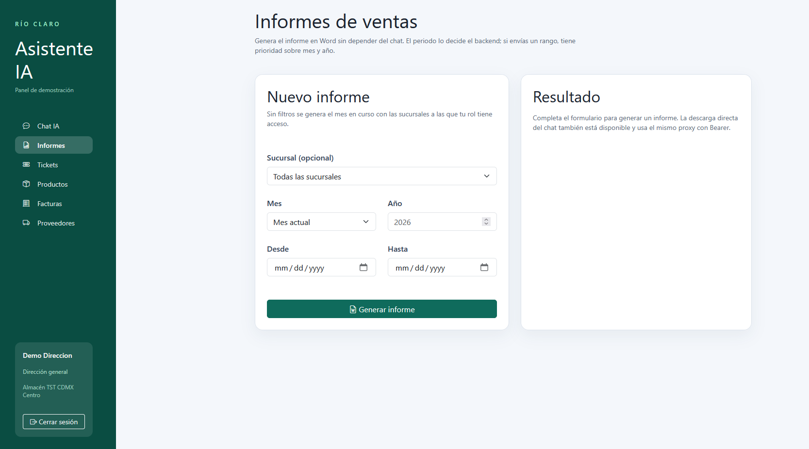

# Distribuidora Río Claro

## 1. Descripción general

Río Claro es una plataforma web para la gestión comercial de una distribuidora de productos de limpieza. Está integrada por:

- Un backend REST desarrollado con Java y Spring Boot.
- Un frontend desarrollado con Next.js, React y TypeScript.
- Servicios de inteligencia artificial de Microsoft Azure.
- Una base de datos para la gestión de la información comercial.

### Repositorios del proyecto
- Cliente Web: 
- API REST: 
## 2. Funcionalidades administrativas del frontend

El frontend permite acceder a los siguientes módulos administrativos:

### Inicio de sesión

La aplicación cuenta con autenticación de usuarios mediante sesiones protegidas. El acceso a las distintas secciones depende de los permisos y roles asignados.

### Asistente de IA

El módulo de asistente permite realizar consultas mediante lenguaje natural sobre:

- Productos.
- Inventario.
- Pedidos.
- Sucursales.
- Almacenes.
- Tickets.
- Informes de ventas.

También permite enviar mensajes de voz, que son convertidos a texto mediante Azure Speech Services antes de ser procesados por el asistente.



La captura muestra el chat interno, con la opción de cambiar entre el asistente para personal autenticado y el asistente público. El chat interno permite consultar productos, inventario, pedidos, sucursales y almacenes, además de crear tickets y solicitar informes.

### Gestión de productos

Desde el frontend se pueden consultar y administrar los productos registrados en el sistema, incluyendo su información comercial y relación con el inventario.

### Gestión de proveedores

El módulo de proveedores permite consultar y administrar la información de los proveedores asociados a la operación de la empresa.



La pantalla presenta el listado paginado de proveedores con su nombre, RFC, correo electrónico y enlace para cargar facturas. También permite abrir o copiar el enlace público para el análisis de documentos, así como crear, editar y eliminar proveedores.

### Gestión de facturas

El frontend permite:

- Consultar facturas.
- Cargar documentos.
- Visualizar la información extraída.
- Revisar el estado de análisis.
- Consultar posibles inconsistencias.
- Dar seguimiento a facturas que requieren revisión.



La captura muestra el formulario para seleccionar un proveedor y cargar una factura en PDF o imagen. Debajo se encuentra el listado de facturas registradas, con filtro por estado, paginación y acceso al detalle de cada documento.

### Análisis de facturas con IA

La aplicación permite analizar facturas en formatos PDF, JPG, JPEG y PNG. El sistema identifica información como:

- Proveedor.
- Número de factura.
- Fechas.
- Subtotal.
- Impuestos.
- Total.
- Moneda.
- Conceptos o productos incluidos.

Además, detecta posibles duplicados, datos faltantes, baja confianza en la extracción y diferencias en los importes.

### Gestión de tickets

El frontend permite:

- Consultar la lista de tickets.
- Visualizar el detalle de cada ticket.
- Revisar mensajes.
- Asignar tickets.
- Actualizar su estado.
- Consultar la calificación o seguimiento de la atención.



La pantalla muestra los tickets con su asunto, cliente, estado, tema, canal, responsable y fecha de creación. Desde cada registro se puede abrir el detalle para revisar la solicitud, actualizar su estado, asignarla y dar seguimiento a la atención.

### Informes

El módulo de informes permite consultar información relacionada con las ventas y descargar los reportes generados por el backend.



La vista permite seleccionar una sucursal, mes, año o rango de fechas. Después de completar el formulario, el sistema genera un informe de ventas que puede consultarse y descargarse.

## 3. Tecnologías utilizadas

### Backend

El backend utiliza:

- Java 25.
- Spring Boot 4.1.1.
- Spring Web MVC.
- Spring Data JPA.
- Spring Security.
- JWT.
- BCrypt.
- Maven.
- Azure AI Agents.
- Azure AI Document Intelligence.
- Azure Speech Services.
- Azure Blob Storage.
- Apache PDFBox.
- Apache POI.

### Frontend

El frontend está desarrollado con:

- Next.js 16.
- React 19.
- TypeScript.
- Bootstrap 5.
- Bootstrap Icons.
- Tailwind CSS.
- ESLint.


## 4. Funcionalidades de inteligencia artificial

La solución incorpora tres capacidades principales de IA:

1. **Asistente conversacional:** responde preguntas sobre la operación comercial y puede consultar información mediante herramientas conectadas al backend.
2. **Análisis de facturas:** utiliza Azure AI Document Intelligence para extraer y validar información de documentos.
3. **Transcripción de voz:** utiliza Azure Speech Services para convertir mensajes de audio en texto.

## 5. Creación de los agentes de IA

Río Claro utiliza dos agentes especializados en Azure AI Foundry. La
configuración se encuentra en `FoundryConfig` y cada agente tiene su propio
prompt, referencia y conjunto de herramientas. El backend usa
`DefaultAzureCredential` para autenticarse contra el proyecto de Foundry y toma
el endpoint y el despliegue desde variables de entorno.

### 5.1 Asistente público de Río Claro

El agente `asistente-rio-claro` atiende a clientes y usuarios externos. Se
crea a partir del prompt asistente-rio-claro.txt,
que establece que debe responder en español, consultar únicamente un pedido
cuando el usuario proporciona su código completo y pedir confirmación antes de
crear un ticket. Además, tiene cargadas en sus conocimientos las políticas de
la empresa para orientar sus respuestas. Estas políticas son datos ficticios
generados exclusivamente para el prototipo y la demostración, y se encuentran
en la carpeta [`Documentos`](../Documentos):

- [`Politica_Cumplimiento_Externo_Rio_Claro.docx`](../Documentos/Politica_Cumplimiento_Externo_Rio_Claro.docx)
- [`Politicas_Internas_Rio_Claro.docx`](../Documentos/Politicas_Internas_Rio_Claro.docx)

Para evitar exponer información interna, este agente recibe únicamente las
herramientas marcadas como públicas:

- `listar_sucursales`
- `consultar_pedido`
- `crear_ticket`

El agente no puede listar pedidos, consultar inventario, generar informes ni
acceder directamente a operaciones administrativas. Si el usuario reporta un
problema, el prompt exige resumirlo y obtener una confirmación expresa antes de
registrar el ticket. También contempla mensajes transcritos por voz y solicita
confirmar códigos o datos exactos que pudieran haberse transcrito
incorrectamente.

### 5.2 Agente de inventario y operaciones internas

El agente `agente-inventario` atiende al personal autenticado. Su prompt está
definido en agente-inventario.txt
y le permite apoyar consultas operativas sobre inventario, productos, pedidos,
sucursales, almacenes, tickets e informes de ventas.

Entre sus herramientas se encuentran:

- `buscar_producto`
- `consultar_inventario`
- `listar_sucursales` y `listar_almacenes`
- `listar_pedidos` y `consultar_pedido`
- `generar_informe_ventas`
- `crear_ticket`

El contexto del usuario autenticado se obtiene del JWT y se envía al ejecutar
cada herramienta. Por eso las herramientas pueden aplicar el rol, la sucursal
y el almacén asignados, en lugar de confiar en identificadores proporcionados
por el modelo. Además, el prompt indica que los filtros, estados y categorías
internas no deben mostrarse como términos técnicos al usuario.

### Proceso de creación de las herramientas

Las herramientas se implementaron como clases Java que cumplen el contrato de
`AgentTool`. Cada herramienta define:

- Un nombre que el modelo puede solicitar, por ejemplo
  `buscar_producto`, `consultar_inventario` o `crear_ticket`.
- Una descripción en lenguaje natural que explica cuándo debe utilizarse.
- Sus propiedades de entrada y los parámetros obligatorios.
- Un método `execute` que valida los argumentos, consulta los servicios y
  repositorios del backend, y devuelve el resultado en texto.
- El contexto del usuario, que permite validar el rol, la sucursal y el almacén
  antes de consultar o modificar información.

Las herramientas se crearon de acuerdo con las operaciones del negocio:

- Consultar sucursales, almacenes, productos, inventario y pedidos.
- Generar informes de ventas por sucursal y periodo.
- Registrar tickets vinculados con un pedido.

Para controlar el acceso, cada herramienta puede indicar si es pública mediante
`isPublic()` y qué roles tienen autorización mediante `allowedRoles()`. Las
operaciones internas, como consultar inventario o generar informes, validan el
contexto autenticado antes de ejecutar la consulta. Las operaciones sensibles,
como crear un ticket, también validan que el usuario haya confirmado la acción.

Finalmente, `ToolRegistry` reúne las implementaciones de `AgentTool` y genera
para cada una una definición de función con su nombre, descripción, propiedades
y parámetros requeridos. Cuando el modelo solicita una función, el backend
localiza la herramienta por nombre, convierte los argumentos JSON y ejecuta su
implementación con el contexto de seguridad correspondiente.

## 6. Principios de IA responsable: evidencia del prototipo

El examen no evalúa únicamente definiciones. En Río Claro, cada principio debe
relacionarse con una situación observable del prototipo y con una evidencia
concreta. La siguiente tabla resume cómo se responde cada pregunta:

| Principio | Respuesta para Río Claro | Evidencia del prototipo |
|---|---|---|
| **Equidad** | El agente no debe favorecer a la sucursal que tenga más datos. Las consultas de sucursales, almacenes, inventario, clientes, pedidos e informes reciben la sucursal como filtro explícito y aplican permisos según el rol del usuario. | Las herramientas del asistente validan roles y filtros de sucursal; por ejemplo, un gerente de sucursal trabaja con su ámbito y los roles administrativos pueden consultar todas las sucursales o filtrar una en particular. La prueba debe comparar la misma pregunta con datos de varias sucursales. |
| **Confiabilidad y seguridad** | Si una factura está borrosa o el OCR tiene baja confianza, el sistema no debe inventar el total: la factura queda identificada para revisión humana. | Azure AI Document Intelligence devuelve confianza por campo. El prototipo marca la regla `LOW_CONFIDENCE` cuando los campos importantes están por debajo de `0.80`, y permite revisar la factura mediante `POST /invoice/{id}/review`. |
| **Privacidad y seguridad** | La información sensible debe enviarse solo a los servicios que la necesitan. En el prototipo, el backend protege los endpoints con JWT, contraseñas BCrypt y roles. La integración específica con Entra ID y Azure Key Vault debe completarse y demostrarse en el despliegue; no se debe presentar como implementada si solo está configurada como objetivo de arquitectura. | El frontend no expone la clave de Speech: envía el audio al backend, que consume Azure Speech Services. Las credenciales y secretos se leen mediante configuración del entorno. Para la evidencia final se debe mostrar el uso de Entra ID y Key Vault en Azure, o declarar esta parte como pendiente. |
| **Inclusión** | El personal de bodega puede interactuar con el asistente por voz, además de texto, lo que reduce la dependencia del teclado. La interfaz web puede abrirse desde un celular, pero conviene validar explícitamente el flujo en ese dispositivo. | El asistente convierte audio a texto con Azure Speech Services antes de procesarlo. La evidencia debe incluir una consulta hecha por voz desde un teléfono y comprobar que los controles y resultados siguen siendo utilizables en una pantalla pequeña. |
| **Transparencia** | El usuario debe saber que está conversando con una IA y qué información sustenta la respuesta. | La aplicación separa el asistente interno del asistente público y presenta el módulo como asistente de IA. En facturas se muestran los datos extraídos, el estado del análisis, las inconsistencias y el documento original. Para cumplir completamente el principio, cada respuesta conversacional debe mostrar también la fuente o el documento consultado; si todavía no aparece, debe registrarse como mejora pendiente. |
| **Rendición de cuentas** | La IA solo recomienda; una persona autorizada revisa y aprueba acciones sensibles, especialmente antes de pagar una factura. | La revisión de facturas está restringida a `ADMIN`, `BOSS`. El sistema registra quién revisó (`reviewedBy`) y cuándo (`reviewedAt`), por lo que la empresa puede identificar al responsable de la decisión. |


## 7. Arquitectura en Azure

Actualmente, la solución utiliza los siguientes servicios:

- **Backend:** Azure App Service.
- **Frontend:** Azure App Service.
- **Base de datos:** Azure SQL Database.
- **Almacenamiento de facturas:** Azure Blob Storage.
- **Asistentes de IA:** Azure AI Foundry / Azure OpenAI.
- **Análisis de documentos:** Azure AI Document Intelligence.
- **Transcripción de voz:** Azure Speech Services.

La comunicación general es:

```text
Usuario
   |
   v
Frontend Next.js en Azure App Service
   |
   v
Backend Spring Boot en Azure App Service
   |
   +--> Azure SQL Database
   +--> Azure Blob Storage
   +--> Azure AI Foundry / Azure OpenAI
   +--> Azure AI Document Intelligence
   +--> Azure Speech Services
```

## 8. Datos de prueba

La carpeta [`/DB`](.) contiene los scripts para cargar un
escenario comercial reproducible en SQL Server o Azure SQL. Los scripts usan
identificadores y códigos de prueba, principalmente con el prefijo `TST-`, por
lo que sus registros se distinguen de los datos reales.

### Scripts de carga

- [`init-sql-data.sql`](./DB/init-sql-data.sql) registra los roles del sistema:
  `BOSS`, `ADMIN`, `BRANCH_MANAGER`, `WAREHOUSE_HEAD` y `ADMIN_SUPPORT`.
- [`seed-data.sql`](./DB/seed-data.sql) carga la información comercial completa
  dentro de una transacción. Incluye:
  - 5 sucursales, cuatro activas y una inactiva.
  - 6 almacenes, incluidos almacenes activos e inactivos distribuidos entre las
    sucursales.
  - 6 categorías y 24 productos de limpieza con SKU, unidad y precio.
  - 5 proveedores con RFC y correos de prueba.
  - 30 registros de inventario con existencias distintas, incluidos productos
    sin existencias y cantidades bajas.
  - 10 clientes de tipo hotel, escuela y tienda, asociados a distintas
    sucursales o sin sucursal asignada.
  - 12 órdenes con partidas, fechas, importes y estados
    `DELIVERED`, `SHIPPED`, `PREPARING`, `RECEIVED` y `CANCELED`.
  - 10 tickets con canales `EMAIL`, `PORTAL` y `VOICE`, estados abiertos,
    pendientes y resueltos, sentimiento, tema y casos que requieren revisión
    humana.
  - Mensajes de tickets con participantes `CUSTOMER`, `AGENT` y `EMPLOYEE`,
    incluyendo acciones como consultar órdenes, buscar políticas, crear tickets
    y escalar casos.

Ambos scripts emplean `MERGE` con identificadores fijos, por lo que pueden
ejecutarse nuevamente sin duplicar los registros. Deben ejecutarse después de
que Hibernate haya creado las tablas; el script `seed-data.sql` confirma la
carga mediante consultas de conteo al finalizar.

### Casos que se pueden demostrar

Estos datos permiten probar directamente:

- Consultas del asistente sobre sucursales, almacenes, productos e inventario.
- Comparaciones de existencias y ventas entre sucursales.
- Búsqueda de proveedores, clientes y órdenes por código o estado.
- Generación de informes con distintos rangos de fechas y sucursales.
- Seguimiento de órdenes entregadas, enviadas, en preparación, recibidas o
  canceladas.
- Creación, asignación, actualización y escalamiento de tickets.
- Atención de solicitudes por correo, portal y voz.
- Respuestas sustentadas en acciones y fuentes registradas en los mensajes de
  los tickets, como `orders:TST-...` y `policy:...`.

### Credenciales de prueba

Las siguientes cuentas están destinadas únicamente al entorno de desarrollo y
demostración. Todas utilizan la contraseña `Demo@1234`.

| Usuario | Correo | Rol | Sucursal | Almacén |
|---|---|---|---|---|
| Demo Direccion | `demo.boss@ai901.local` | `BOSS` | `TST-CDMX` | `TST-ALM-CDMX1` |
| Demo Administracion | `demo.admin@ai901.local` | `ADMIN` | `TST-CDMX` | `TST-ALM-CDMX1` |
| Demo Gerente de Sucursal | `demo.branch@ai901.local` | `BRANCH_MANAGER` | `TST-CDMX` | `TST-ALM-CDMX1` |
| Demo Jefe de Almacen | `demo.warehouse@ai901.local` | `WAREHOUSE_HEAD` | `TST-CDMX` | `TST-ALM-CDMX1` |

Los `roleId` corresponden, en el mismo orden de la tabla, a:

```text
BOSS             11111111-1111-4111-8111-000000000001
ADMIN            11111111-1111-4111-8111-000000000002
BRANCH_MANAGER   11111111-1111-4111-8111-000000000003
WAREHOUSE_HEAD   11111111-1111-4111-8111-000000000004
```

## 9. Conclusión

Río Claro integra módulos administrativos para la operación comercial con herramientas de inteligencia artificial. El frontend centraliza la gestión de productos, proveedores, facturas, tickets e informes, además de ofrecer un asistente capaz de consultar información empresarial mediante texto o voz.

La solución utiliza Azure para alojar sus aplicaciones, almacenar documentos y consumir servicios de inteligencia artificial especializados.
